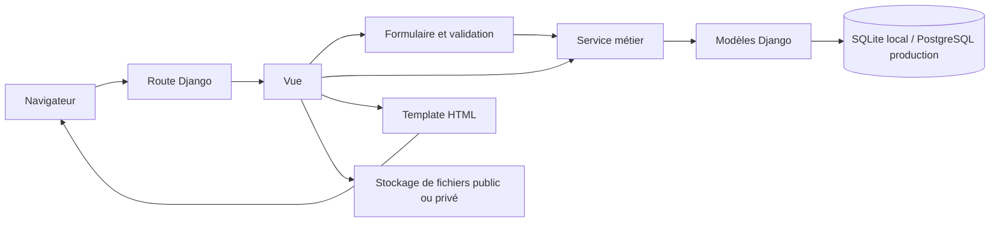

# Conception de la base de données et des routes

> Documentation de conception de l'application Dunia, alignée sur les modèles et les routes Django existants. Ce document décrit l'implémentation actuelle; il ne définit pas une API REST distincte.

Le schéma exploitable par un éditeur ERD est disponible dans [`erd-schema.json`](erd-schema.json). C'est un JSON neutre contenant `entities` (tables/champs) et `relationships` (clés étrangères et relations plusieurs-à-plusieurs, avec tables de jointure). Il est généré depuis les métadonnées Django; si ton éditeur impose un format propriétaire, il faudra convertir cette structure vers son format d'import.

## 1. Architecture

Dunia est un monolithe Django rendu côté serveur. Les URL distribuent les requêtes vers les vues, qui valident les formulaires, appliquent les règles métier via les services et lisent ou modifient les modèles.

Le schéma SQL est généré et versionné par les migrations Django de `dunia_app`. Les fichiers (images, vidéos, PDF et CV) résident dans le stockage média, et non dans les colonnes de la base. Les CV et justificatifs de candidature utilisent un stockage privé et doivent être délivrés par les vues protégées.

## 2. Schéma relationnel

Le diagramme montre les relations métier principales. `User` désigne le modèle utilisateur standard de Django. Les relations plusieurs-à-plusieurs avec table intermédiaire sont représentées explicitement lorsqu'elles portent des informations métier.

```mermaid
erDiagram
    USER ||--o| USER_PROFILE : possede
    USER ||--o| TRAINER_PROFILE : possede
    USER ||--o{ ROLE_REQUEST : demande
    USER ||--o{ SOCIAL_POST : publie
    USER ||--o{ PUBLICATION : redige
    USER ||--o{ FRIENDSHIP : participe
    USER ||--o{ CONVERSATION : participe
    CONVERSATION ||--o{ MESSAGE : contient
    USER ||--o{ MESSAGE : envoie
    USER ||--o{ FEED_LIKE : aime
    USER ||--o{ FEED_COMMENT : commente
    USER ||--o{ FEED_SHARE : partage
    SOCIAL_POST o|--o{ FEED_LIKE : recoit
    PUBLICATION o|--o{ FEED_LIKE : recoit
    SOCIAL_POST o|--o{ FEED_COMMENT : recoit
    PUBLICATION o|--o{ FEED_COMMENT : recoit
    SOCIAL_POST o|--o{ FEED_SHARE : recoit
    PUBLICATION o|--o{ FEED_SHARE : recoit

    INFORMATION ||--o{ TRAINING_SESSION : planifie
    INFORMATION ||--o{ FORMATION_FAQ : documente
    INFORMATION ||--o{ CANDIDATURE : recoit
    USER ||--o{ CANDIDATURE : soumet
    TRAINING_SESSION o|--o{ CANDIDATURE : concerne
    TRAINING_SESSION ||--o{ SESSION_RESERVATION : recoit
    INFORMATION ||--o{ DEMANDE_AIDE_FINANCIERE : concerne
    USER ||--o{ LEARNING_PROGRESS : suit
    COURS ||--o{ LEARNING_PROGRESS : est_suivi
    USER ||--o{ LEARNING_GOAL : definit
    USER ||--o{ COURS : forme
    COURS ||--o{ COURSE_EVALUATION : recoit
    USER ||--o{ COURSE_EVALUATION : evalue
    USER ||--o{ USER_CREDENTIAL : recoit
    CREDENTIAL ||--o{ USER_CREDENTIAL : attribue

    USER ||--o{ BUSINESS_PROFILE : gere
    BUSINESS_PROFILE ||--o{ JOB_POSTING : publie
    JOB_POSTING ||--o{ JOB_APPLICATION : recoit
    USER ||--o{ JOB_APPLICATION : postule
    USER ||--o{ PROJECT_SUBMISSION : depose
    PROJECT_SUBMISSION ||--o{ PROJECT_COLLABORATOR : implique
    USER ||--o{ PROJECT_COLLABORATOR : collabore
    COMMUNITY ||--o{ COMMUNITY_MEMBERSHIP : regroupe
    USER ||--o{ COMMUNITY_MEMBERSHIP : rejoint
    COMMUNITY ||--o{ COMMUNITY_ACCESS_REQUEST : recoit
    USER ||--o{ COMMUNITY_ACCESS_REQUEST : demande_acces
    COMMUNITY ||--o{ COMMUNITY_POST : contient
    USER ||--o{ COMMUNITY_POST : redige
    PROFESSIONAL_EVENT ||--o{ EVENT_REGISTRATION : recoit
    USER ||--o{ EVENT_REGISTRATION : s_inscrit

    CHALLENGE ||--o{ CHALLENGE_PARTICIPATION : accueille
    USER ||--o{ CHALLENGE_PARTICIPATION : participe
    CHALLENGE_PARTICIPATION ||--o{ CHALLENGE_PAYMENT_ATTEMPT : historise
    CHALLENGE_PARTICIPATION ||--o{ CHALLENGE_WORK_SUBMISSION : recoit
    USER ||--o{ NOTIFICATION : recoit
    USER o|--o{ AUDIT_LOG : agit
    BLOG_CATEGORY o|--o{ ARTICLE : classe
    USER ||--o{ ARTICLE : redige
```

`FeedLike`, `FeedComment` et `FeedShare` ciblent soit une publication sociale (`SocialPost`), soit une publication éditoriale (`Publication`), jamais les deux à la fois. Les contraintes de base de données appliquent cette règle; les « 0 ou 1 » du diagramme indiquent ce choix exclusif.

### Modèles regroupés par domaine

| Domaine | Entités et principales relations |
| --- | --- |
| Comptes et rôles | `User` (Django), `UserProfile`, `TrainerProfile`, `RoleRequest`, `BusinessProfile`; extensions de profil et demandes liées à un utilisateur. |
| Fil social | `SocialPost`, `Publication`, `FeedLike`, `FeedComment`, `FeedShare`, `Friendship`; interactions rattachées à un auteur et à une cible. |
| Messagerie | `Conversation`, `Message`; une conversation a deux participants et contient des messages. |
| Formation | `Information`, `TrainingSession`, `FormationFAQ`, `SessionReservation`, `Candidature`, `DemandeAideFinanciere`, `Partner`, `Campus`; sessions et demandes rattachées aux formations. `Information`–`Partner` et `Campus`–`Information` sont plusieurs-à-plusieurs. |
| Apprentissage | `Cours`, `LearningProgress`, `LearningGoal`, `CourseEvaluation`, `Credential`, `UserCredential`; progression et évaluations relient utilisateur et cours; `Credential` peut relier plusieurs cours/formations. |
| Emploi et projets | `BusinessProfile`, `JobPosting`, `JobApplication`, `ProjectSubmission`, `ProjectCollaborator`, `LearnerProjectRequest`; une candidature d'emploi relie une offre et un candidat; les collaborateurs sont invités sur un projet. |
| Communautés et événements | `Community`, `CommunityMembership`, `CommunityAccessRequest`, `CommunityPost`, `ProfessionalEvent`, `EventRegistration`; adhésions, demandes et inscriptions sont des entités associatives avec leurs propres statuts et dates. |
| Défis | `Challenge`, `ChallengeParticipation`, `ChallengePaymentAttempt`, `ChallengeWorkSubmission`; les tentatives de paiement et remises sont conservées sous la participation. |
| Contenu et impact | `BlogCategory`, `Article`, `Comment`, `Contact`, `Testimonial`, `Initiative`, `ImpactMetric`, `AnnualReport`; `Comment` porte sur une publication ou un article, mais pas les deux simultanément. |
| Système et suivi | `Notification`, `AuditLog`; l'audit conserve l'acteur éventuel, l'objet visé via `ContentType` et ses détails JSON. |

### Contraintes de conception importantes

- Les relations à plusieurs valeurs métier utilisent des clés étrangères; les associations ayant un état ou un historique propre utilisent un modèle dédié (par exemple `CommunityMembership`, `JobApplication`).
- Des contraintes d'unicité empêchent notamment les doublons d'inscription à une offre, de membre dans une communauté et de participant à un défi.
- Les flux de formation, de cours, de défis et de candidature possèdent des statuts. Leurs transitions sensibles passent par les services métier et leurs transactions, pas par une mise à jour ad hoc depuis une vue.
- L'historique des paiements de défis et des remises de travail est porté par `ChallengePaymentAttempt` et `ChallengeWorkSubmission`.
- Le modèle `AuditLog` est un journal d'événements; il référence génériquement l'objet audité au moyen de `ContentType` et `object_id`.
- Les règles détaillées et champs exhaustifs sont ceux des modèles et migrations, en particulier [`dunia_app/models.py`](dunia_app/models.py) et [`dunia_app/migrations/`](dunia_app/migrations/).

## 3. Conception des routes

Les routes sont définies dans [`dunia_app/urls.py`](dunia_app/urls.py), montées à la racine par [`dunia_one/urls.py`](dunia_one/urls.py). Ce sont des routes de pages et d'actions de formulaires Django, pas des endpoints REST JSON. Les méthodes HTTP autorisées sont celles des vues correspondantes; les opérations de lecture utilisent généralement `GET` et les formulaires/actions utilisent `POST`. Les noms ci-dessous sont les noms Django à privilégier avec `` ou `reverse()`.

| Domaine | Nom de route | Chemin |
| --- | --- | --- |
| Accueil et fil | `home` | `/` |
|  | `social_post_create` | `/fil/publier/` |
|  | `feed_toggle_like` | `/fil/<item_type>/<item_id>/aimer/` |
|  | `feed_comment_create` | `/fil/<item_type>/<item_id>/commenter/` |
|  | `feed_record_share` | `/fil/<item_type>/<item_id>/partager/` |
|  | `social_post_detail` | `/fil/publication/<post_id>/` |
| Membres | `amis` | `/amis/` |
|  | `demande_ami` | `/amis/<user_id>/demander/` |
|  | `demande_ami_action` | `/amis/demandes/<friendship_id>/<action>/` |
|  | `profil_public` | `/membre/<username>/` |
| Contenu éditorial | `detail` | `/publication/<slug>/` |
|  | `article_list` | `/articles/` |
|  | `article_detail` | `/articles/<slug>/` |
|  | `articles_categorie` | `/articles/categorie/<slug>/` |
|  | `comment_create` | `/commentaire/` |
| Formation | `home_b` | `/formations/` |
|  | `info_detail` | `/formation/<slug>/` |
|  | `orientation_quiz` | `/orientation/` |
|  | `calendrier_sessions` | `/calendrier/` |
|  | `candidature_create` | `/formation/<slug>/candidature/` |
|  | `candidature_document_download` | `/mon-espace/candidatures/<candidature_id>/document/` |
|  | `candidature_suivi` | `/candidature/suivi/` |
|  | `aide_financiere_create` | `/formation/<slug>/aide-financiere/` |
|  | `aide_financiere_confirmation` | `/aide-financiere/confirmation/<reference>/` |
|  | `aide_financiere_suivi` | `/aide-financiere/suivi/` |
|  | `session_reservation_create` | `/session/<session_id>/reserver/` |
| Navigation et contact | `decouvrir` | `/decouvrir/` |
|  | `service` | `/services/` |
|  | `post` | `/posts/` |
|  | `contact_create` | `/contact/` |
| Authentification | `inscription` | `/inscription/` |
|  | `connexion` | `/connexion/` |
|  | `deconnexion` | `/deconnexion/` |
|  | `password_reset` | `/mot-de-passe/oublie/` |
|  | `password_reset_done` | `/mot-de-passe/envoye/` |
|  | `password_reset_confirm` | `/mot-de-passe/reinitialiser/<uidb64>/<token>/` |
|  | `password_reset_complete` | `/mot-de-passe/termine/` |
| Espace membre | `tableau_bord` | `/mon-espace/` |
|  | `profil_modifier` | `/mon-espace/profil/` |
|  | `mes_formations` | `/mon-espace/formations/` |
|  | `notification_mark_read` | `/mon-espace/notifications/<notification_id>/lire/` |
|  | `objectif_creer` | `/mon-espace/objectifs/creer/` |
|  | `objectif_modifier` | `/mon-espace/objectifs/<goal_id>/modifier/` |
|  | `objectif_action` | `/mon-espace/objectifs/<goal_id>/<action>/` |
| Apprentissage et certificats | `cours_list` | `/cours/` |
|  | `cours_detail` | `/cours/<slug>/` |
|  | `cours_demarrer` | `/cours/<slug>/demarrer/` |
|  | `cours_terminer` | `/cours/<slug>/terminer/` |
|  | `cours_evaluer` | `/cours/<slug>/evaluer/` |
|  | `credential_list` | `/certificats/` |
|  | `user_credential_download` | `/mon-espace/certificats/<reference>/telecharger/` |
|  | `credential_verify` | `/certificats/verifier/<reference>/` |
| Espace formateur | `formateur_demande` | `/mon-espace/formateur/demande/` |
|  | `formateur_cours` | `/mon-espace/formateur/cours/` |
|  | `formateur_cours_creer` | `/mon-espace/formateur/cours/creer/` |
|  | `formateur_cours_modifier` | `/mon-espace/formateur/cours/<cours_id>/modifier/` |
| Messagerie | `messagerie` | `/messagerie/` |
|  | `conversation_demarrer` | `/messagerie/nouveau/<username>/` |
|  | `conversation_detail` | `/messagerie/<conversation_id>/` |
| Entreprises et emploi | `offres_emploi` | `/emplois/` |
|  | `offre_detail` | `/emplois/<slug>/` |
|  | `job_application_cv_download` | `/mon-espace/candidatures-emploi/<application_id>/cv/` |
|  | `espace_entreprises` | `/entreprises/` |
|  | `entreprise_creer` | `/entreprises/inscrire/` |
|  | `entreprise_modifier` | `/entreprises/<business_id>/modifier/` |
|  | `offre_creer` | `/entreprises/<business_id>/offre/creer/` |
|  | `entreprise_candidatures` | `/entreprises/<business_id>/offres/<job_id>/candidatures/` |
| Projets | `galerie_projets` | `/projets/` |
|  | `projet_deposer` | `/projets/deposer/` |
|  | `projet_modifier` | `/mon-espace/projets/<project_id>/modifier/` |
|  | `projet_collaborateur_inviter` | `/mon-espace/projets/<project_id>/inviter/` |
|  | `projet_invitation_action` | `/mon-espace/projets/invitations/<invitation_id>/<action>/` |
|  | `projet_client` | `/projet-client/` |
| Communautés et événements | `communautes` | `/communautes/` |
|  | `communaute_detail` | `/communautes/<slug>/` |
|  | `formateurs` | `/formateurs/` |
|  | `evenements_pro` | `/evenements-professionnels/` |
|  | `evenement_inscription` | `/evenements-professionnels/<slug>/inscription/` |
|  | `evenement_annulation` | `/evenements-professionnels/<slug>/annulation/` |
| Défis, campus et impact | `initiatives` | `/initiatives/` |
|  | `challenge_list` | `/challenges/` |
|  | `challenge_detail` | `/challenges/<slug>/` |
|  | `challenge_enroll` | `/challenges/<slug>/inscription/` |
|  | `challenge_report_payment` | `/challenges/<slug>/paiement/` |
|  | `challenge_submit` | `/challenges/<slug>/soumettre/` |
|  | `impact` | `/impact/` |
|  | `campus_list` | `/campus/` |
|  | `annuaire_apprenants` | `/annuaire-apprenants/` |

L'administration Django est disponible sur `/admin/` et est déclarée dans [`dunia_one/urls.py`](dunia_one/urls.py). Le service de développement peut aussi servir les fichiers médias à partir de `MEDIA_URL`; en production, le stockage et la livraison de fichiers doivent respecter la séparation public/privé.

## 4. Repères de maintenance

- Ajouter ou modifier une colonne ou une relation : modifier le modèle, générer une migration, puis exécuter les tests concernés.
- Ajouter une page ou une action : déclarer une route nommée, implémenter la vue et ses validations/permissions, puis couvrir le parcours par un test.
- Utiliser les services existants pour toute transition transactionnelle ou décision nécessitant un audit.
- Vérifier les permissions de propriétaire et le stockage privé pour les téléchargements.
- Le code source faisant foi pour les champs détaillés, contraintes, vues, méthodes HTTP et permissions reste celui des modèles, formulaires, services et URLconf.
