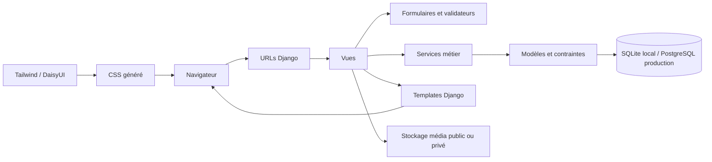

# Dunia — Guide technique

> Documentation d’accueil destinée aux personnes qui développent et maintiennent la plateforme. État vérifié dans le workspace le 13 novembre 2026; revoir les sections « Migrations » et « Tests » lorsque le projet évolue.

**[Lire le guide complet du projet](GUIDE_PROJET.md)** — fonctionnalités déjà livrées, limites connues, travaux restants et procédure de mise en production.

## 1. Vue d’ensemble

Dunia est une application web de formation et de communauté. Elle réunit un catalogue de formations et de cours, des candidatures, des espaces pour apprenants, formateurs et entreprises, des fonctionnalités sociales, des défis et des outils de suivi d’impact.

L’application est un monolithe Django rendu côté serveur : les vues reçoivent les requêtes, les formulaires valident les entrées, les services centralisent les transitions métier, puis les templates produisent les pages HTML. Le JavaScript améliore certaines interactions du fil social; Tailwind CSS et DaisyUI fournissent les styles.

### Technologies

- Python et Django 6.0.6; le workspace a été contrôlé avec Python 3.14.
- SQLite en développement; PostgreSQL requis en production.
- Templates Django, formulaires HTML et quelques interactions JavaScript.
- Tailwind CSS 4, DaisyUI 5 et Node.js/npm pour la compilation CSS.
- Pillow pour le traitement des images.

## 2. Architecture du dépôt

| Chemin | Rôle |
| --- | --- |
| [dunia_one/settings.py](dunia_one/settings.py) | Configuration Django, variables d’environnement, sécurité, cache et stockage. |
| [dunia_one/urls.py](dunia_one/urls.py) | Route racine vers l’administration et l’application principale. |
| [dunia_app/models.py](dunia_app/models.py) | Modèles métier et contraintes de données. |
| [dunia_app/urls.py](dunia_app/urls.py) | Routes web de l’application. |
| [dunia_app/views.py](dunia_app/views.py) | Vues fonctionnelles et génériques : présentation, formulaires, accès et réponses. |
| [dunia_app/services.py](dunia_app/services.py) | Règles métier transactionnelles : approbations, transitions, capacités, audit. Utiliser ces services pour les changements de statut sensibles. |
| [dunia_app/forms.py](dunia_app/forms.py) | Formulaires, validation des données et des uploads. |
| [dunia_app/admin.py](dunia_app/admin.py) | Administration Django, actions de validation et accès aux historiques. |
| [dunia_app/validators.py](dunia_app/validators.py) | Validation de taille et signature des fichiers. |
| [dunia_app/storage.py](dunia_app/storage.py) | Stockage privé des pièces de candidature. |
| [dunia_app/throttling.py](dunia_app/throttling.py) | Limitation de débit des formulaires et actions ciblés. |
| [dunia_app/templates/dunia_app](dunia_app/templates/dunia_app) | Pages HTML et composants réutilisables dans `partials/`. |
| [dunia_app/static](dunia_app/static) | Sources CSS/JS et ressources statiques. |
| [dunia_app/migrations](dunia_app/migrations) | Historique du schéma et migrations de données. |
| [dunia_app/tests.py](dunia_app/tests.py) | Tests Django des vues, services, permissions, migrations et templates. |
| [dunia_app/management/commands](dunia_app/management/commands) | Commandes de conversion WebP et migration des fichiers privés. |
| [DEPLOIEMENT_SECURISE.md](DEPLOIEMENT_SECURISE.md) | Procédure de sécurité et de mise en production, notamment pour les documents privés. |

### Schéma général des requêtes



## 3. Fonctionnalités présentes

### Comptes, profils et communauté

- Inscription, connexion, déconnexion et réinitialisation de mot de passe avec l’utilisateur Django standard.
- Profils d’apprenants, profils formateurs et profils d’entreprise.
- Demandes d’amitié, fil social, publications, réactions, commentaires et partages.
- Messagerie directe, états de lecture et notifications.
- Communautés avec adhésion et publications réservées aux membres lorsque nécessaire.

### Formation et apprentissage

- Catalogue de formations, filtres, orientation, pages détaillées, FAQ et calendrier des sessions.
- Candidatures avec référence de suivi, demandes d’aide financière et réservations de sessions d’information.
- Cours vidéo, audio ou PDF, suivi de progression et évaluations.
- Espace formateur pour soumettre et modifier des cours.

### Entreprises, emploi et projets

- Profils d’entreprise, offres d’emploi, candidatures et consultation des dossiers par l’entreprise autorisée.
- Galerie de projets d’apprenants et formulaire de demande de projet client.
- Les offres et les candidatures sont exposées selon le statut de publication et les droits du propriétaire.

### Défis, événements et contenu

- Défis gratuits ou payants, déclaration manuelle du paiement, remises de travail versionnées et retours d’évaluation.
- Événements professionnels avec inscriptions et capacité.
- Publications éditoriales, articles et catégories, initiatives, campus, indicateurs d’impact, partenaires, témoignages, certifications et rapports annuels.
- Une partie des contenus de gestion (par exemple les indicateurs, certificats et rapports) est maintenue depuis l’administration Django.

Les routes et noms d’URL exacts sont définis dans [dunia_app/urls.py](dunia_app/urls.py). Les vues HTML et les règles d’accès se trouvent dans [dunia_app/views.py](dunia_app/views.py).

## 4. Règles métier à préserver

Les statuts et compteurs ne doivent pas être changés directement dans une vue ou une action admin si un service métier existe déjà.

1. **Rôles** — un formateur ou une entreprise obtient son rôle après approbation par l’équipe Dunia. Pour une entreprise, cette approbation est distincte de la vérification de son profil.
2. **Offres** — une offre est soumise à validation; elle ne peut être publiée que si le rôle de l’entreprise est approuvé et son profil vérifié. Modifier un profil vérifié invalide sa vérification et renvoie ses offres publiées en revue.
3. **Cours** — une création ou une modification de contenu remet le cours en attente de validation avant publication.
4. **Candidatures aux formations** — une place de cohorte est retenue à la confirmation avec une session valide, et libérée lors des transitions qui annulent cette confirmation. Une candidature simplement reçue ne réserve pas de place.
5. **Défis payants** — le paiement est vérifié manuellement. Les tentatives et décisions restent historisées; une tentative refusée peut être suivie d’une nouvelle tentative.
6. **Remises de défi** — chaque nouvelle remise crée une version. Une version suivante est permise après un retour « à corriger »; les versions et avis antérieurs sont conservés.
7. **Audit** — les décisions et changements métier importants sont enregistrés dans `AuditLog`. Ce journal est consultable en administration, mais non modifiable.
8. **Pièces privées** — les CV et justificatifs de candidature ne doivent jamais être servis depuis l’URL publique des médias; leur téléchargement passe par les vues d’accès dédiées.

Les fonctions correspondantes sont principalement dans [dunia_app/services.py](dunia_app/services.py). Elles utilisent des transactions et permissions Django; ajouter ou modifier une règle métier implique également un test.

## 5. Parcours URL utiles

| Domaine | Exemples de routes |
| --- | --- |
| Accueil et contenu | `/`, `/publication/<slug>/`, `/articles/`, `/articles/<slug>/` |
| Authentification | `/inscription/`, `/connexion/`, `/mot-de-passe/oublie/` |
| Formations | `/formations/`, `/formation/<slug>/`, `/orientation/`, `/calendrier/`, `/formation/<slug>/candidature/` |
| Apprentissage | `/cours/`, `/cours/<slug>/`, `/mon-espace/formateur/cours/` |
| Réseau social | `/fil/...`, `/amis/`, `/messagerie/` |
| Entreprises et emploi | `/entreprises/`, `/emplois/`, `/emplois/<slug>/` |
| Projets et communautés | `/projets/`, `/communautes/`, `/communautes/<slug>/` |
| Défis et événements | `/challenges/`, `/evenements-professionnels/` |
| Administration | `/admin/` |

Ce tableau est indicatif; [dunia_app/urls.py](dunia_app/urls.py) est la référence pour les chemins, méthodes et noms de routes.

## 6. Installation locale

### Prérequis

- Python compatible avec Django 6.0 (Python 3.14 est utilisé dans le workspace courant).
- Node.js et npm pour compiler le CSS.

### Première installation

Depuis la racine du dépôt, sur Linux/macOS :

```bash
python3 -m venv .venv
source .venv/bin/activate
python -m pip install --upgrade pip
pip install -r requirements.txt
npm ci
```

Pour une base locale neuve ou jetable, initialiser le schéma et créer éventuellement un compte d’administration :

```bash
python manage.py migrate
python manage.py createsuperuser
```

Lancer le développement avec Tailwind en mode surveillance et Django :

```bash
npm run dev
```

Le shell doit avoir activé `.venv` avant de lancer `npm run dev`, car le script npm exécute `python manage.py runserver`. La tâche VS Code **Dunia: Django + Tailwind dev** fait cette activation. Alternative : lancer `python manage.py runserver` dans un terminal et `npm run dev:css` dans un autre.

### Configuration locale

En développement, `DEBUG` est activé par défaut, le cache est en mémoire locale et les courriels utilisent la console. Le fichier `.env` est ignoré par Git, mais les settings ne le chargent pas automatiquement : fournir les variables via l’environnement du processus ou un gestionnaire de secrets.

En développement, la base configurée par défaut dans [dunia_one/settings.py](dunia_one/settings.py) est SQLite (`db.sqlite3`). En production, définir `DJANGO_DATABASE_URL` avec une URL PostgreSQL; SQLite est refusé lorsque `DJANGO_DEBUG=False`.

## 7. Commandes courantes

Activer d’abord l’environnement Python :

```bash
source .venv/bin/activate
```

Puis :

```bash
python manage.py runserver                    # Serveur Django seul
npm run dev:css                                # Compilation Tailwind en surveillance
python manage.py test dunia_app                # Suite de tests Django
python manage.py check                         # Vérification générale du projet
python manage.py check --deploy                # Contrôles de déploiement avec env de production
python manage.py showmigrations dunia_app      # État des migrations
python manage.py makemigrations --check --dry-run  # Détecter un écart modèles/migrations
```

`npm test` lance également la suite Django; activer `.venv` avant de l’utiliser. Pour préparer les ressources statiques de production, `npm run build:css` compile le CSS sans mode surveillance.

### Commandes de gestion des médias

- `convertir_webp` traite des images existantes; consulter son aide et son mode opératoire avant toute option de suppression.
- `deplacer_documents_prives` est en simulation par défaut. L’option `--apply` copie les documents, vérifie leur empreinte SHA-256 puis supprime les anciennes copies publiques. N’utiliser cette option qu’après sauvegarde vérifiée et pendant la procédure de maintenance décrite dans [DEPLOIEMENT_SECURISE.md](DEPLOIEMENT_SECURISE.md).

## 8. Fichiers et configuration de sécurité

### Médias

- Les médias publics sont sous `MEDIA_ROOT` et servis sous `/media/` en développement.
- Les CV d’emploi et justificatifs de candidature utilisent un stockage privé hors de `MEDIA_ROOT`. Les vues de téléchargement vérifient le propriétaire ou une permission d’équipe et renvoient le fichier en pièce jointe avec des en-têtes empêchant le cache public.
- Les uploads disposent de contrôles d’extension, de taille et, pour les PDF concernés, de signature. Les règles détaillées se trouvent dans [dunia_app/models.py](dunia_app/models.py), [dunia_app/forms.py](dunia_app/forms.py) et [dunia_app/validators.py](dunia_app/validators.py).
- Ne pas committer `db.sqlite3`, `media/`, `private_media/`, les environnements virtuels, `node_modules/` ou des secrets; ces données locales sont ignorées par Git.

### Production

Les réglages importants sont lus depuis l’environnement :

| Variable | But |
| --- | --- |
| `DJANGO_DEBUG` | Désactiver le mode debug en production. |
| `DJANGO_SECRET_KEY` | Secret long, aléatoire et propre à l’environnement. |
| `DJANGO_ALLOWED_HOSTS` | Hôtes servis, séparés par des virgules. |
| `DJANGO_DATABASE_URL`, `DJANGO_DB_CONN_MAX_AGE` | Connexion PostgreSQL et durée des connexions persistantes. |
| `DJANGO_SECURE_SSL_REDIRECT` | Redirection HTTPS après configuration correcte du proxy/TLS. |
| `DJANGO_SESSION_COOKIE_SECURE`, `DJANGO_CSRF_COOKIE_SECURE` | Cookies transmis uniquement en HTTPS. |
| `DJANGO_SECURE_HSTS_SECONDS` | HSTS; commencer prudemment et augmenter après validation de HTTPS. |
| `DJANGO_SECURE_HSTS_INCLUDE_SUBDOMAINS`, `DJANGO_SECURE_HSTS_PRELOAD` | N’activer qu’après vérification de tous les sous-domaines et de la politique de retour arrière. |
| `DJANGO_SECURE_PROXY_SSL_HEADER` | À configurer seulement si le proxy de confiance nettoie et définit lui-même l’en-tête HTTPS. |
| `DJANGO_CSRF_TRUSTED_ORIGINS` | Origines supplémentaires uniquement si le déploiement en utilise. |
| `DJANGO_CACHE_BACKEND`, `DJANGO_CACHE_LOCATION`, `DJANGO_CACHE_KEY_PREFIX` | Cache partagé requis en production pour un throttling cohérent entre workers. |
| `DJANGO_PRIVATE_MEDIA_ROOT` | Répertoire privé hors de la racine média publique. |
| `DJANGO_EMAIL_BACKEND`, `DJANGO_DEFAULT_FROM_EMAIL` | Backend et adresse expéditeur réelle des courriels. |
| `DJANGO_EMAIL_HOST`, `DJANGO_EMAIL_PORT`, `DJANGO_EMAIL_HOST_USER`, `DJANGO_EMAIL_HOST_PASSWORD` | Paramètres SMTP lus depuis l’environnement; TLS est activé par défaut en production. |

SQLite, le cache local en mémoire et le backend courriel console conviennent au développement, pas à une production multi-worker. Gunicorn sert l’application WSGI; après `collectstatic`, le proxy ou l’hébergeur doit servir `STATIC_ROOT` et les médias publics, sans exposer le stockage privé.

Pour les variables exactes, les étapes de build, la configuration du proxy et la procédure de migration des fichiers, suivre [DEPLOIEMENT_SECURISE.md](DEPLOIEMENT_SECURISE.md). Ne jamais mettre une vraie clé secrète dans ce README ni dans Git.

## 9. Migrations et état de la base locale

Les migrations 0001 à 0026 sont appliquées sur la base locale contrôlée. Les migrations suivantes existent mais étaient en attente dans cette base au 12 novembre 2026 :

- **0027** — workflows, audit, contraintes et stockage des pièces de candidature; comprend des vérifications et une reprise de données historiques.
- **0028** — validation de taille des médias et vérification des brochures/rapports PDF.

Les tests créent leur propre base temporaire et appliquent la chaîne complète. La base réelle du workspace n’a pas été modifiée pendant cet audit.

Sur une base fraîche de développement, appliquer les migrations est l’étape normale d’initialisation. Sur une base qui contient déjà des données, ne pas appliquer 0027 sans sauvegarde et analyse préalable : consulter [DEPLOIEMENT_SECURISE.md](DEPLOIEMENT_SECURISE.md), exécuter d’abord les contrôles prévus et vérifier le plan de restauration. La commande de déplacement des documents privés est distincte de la migration de schéma.

## 10. Tests et contribution

Au moment de la rédaction, **60 tests Django passent**. Ils couvrent notamment les parcours de formation, les statuts de cours/offres/candidatures, les capacités de cohorte, les paiements/remises de défi, les permissions de téléchargement privé, le throttling, les templates, la reprise de données de migration et le smoke test des routes nommées et de l’administration.

Avant de proposer une modification :

1. Comprendre la route, le formulaire, le service et le template du parcours concerné.
2. Mettre les règles transactionnelles et de permissions dans `services.py` lorsqu’elles touchent un workflow métier.
3. Ajouter ou adapter un test dans [dunia_app/tests.py](dunia_app/tests.py).
4. Pour un changement de modèle, générer et relire une migration; vérifier qu’il n’y a pas d’écart non migré.
5. Exécuter les tests Django et `manage.py check`.
6. Pour le style, modifier `dunia_app/static/css/input.css`; `output.css` est généré par Tailwind et ne doit pas être édité manuellement.
7. Pour tout fichier sensible, conserver le stockage privé et tester les refus d’accès d’un tiers.

Le dépôt est organisé en une application Django unique. Garder les nouvelles fonctionnalités cohérentes avec cette structure existante; une extraction en sous-applications serait un chantier de refactorisation séparé.
